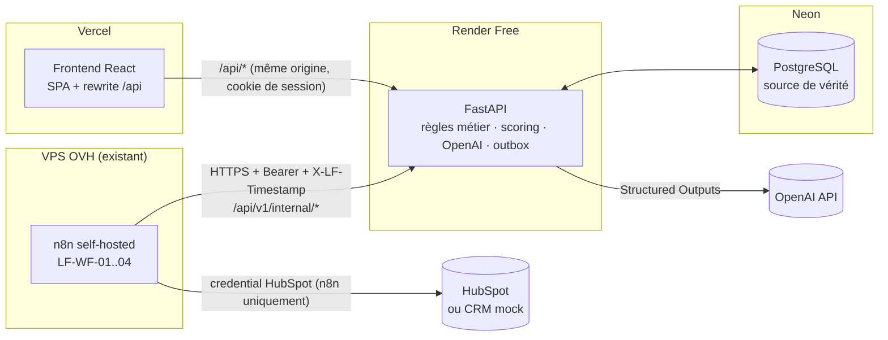

# Architecture et décisions

LeadFlow AI est composé de **quatre briques déployées séparément** qui ne communiquent qu'en HTTPS.

## Responsabilités

| Brique | Rôle | Ne fait jamais |
| --- | --- | --- |
| **Frontend** (Vercel) | Landing, formulaire, dashboard, revue humaine, monitor | Stocker un secret ; décider d'un score ; appeler n8n/OpenAI |
| **FastAPI** (Render) | Validation, persistance, outbox, scoring déterministe, appels OpenAI, machine à états, autorisations, audit | Dépendre d'un processus d'arrière-plan permanent ; envoyer un e-mail |
| **PostgreSQL** (Neon) | Unique source de vérité (leads, événements, runs, audit) | — |
| **n8n** (OVH) | Orchestration : réserve les événements, appelle les endpoints internes, parle à HubSpot | Contenir une clé OpenAI ; réessayer par lui-même ; écrire en base |

## Flux nominal

1. `POST /api/v1/public/leads` : une transaction écrit contact (upsert), lead, événement d'intake, événement **outbox** `LEAD_SUBMITTED` et deux entrées d'audit. La réponse `201` ne dépend ni de l'IA ni du CRM.
2. **LF-WF-04** (réveillé par le backend après chaque soumission — best-effort — et planifié toutes les 20 min en filet de récupération, sur OVH) appelle `POST /internal/outbox/claim` : réservation atomique (`FOR UPDATE SKIP LOCKED`) avec *lease* ; le backend crée le *run* correspondant.
3. WF-04 route chaque événement vers le webhook du workflow enfant (accusé `202` immédiat).
4. **LF-WF-01** : lit le lead → idempotence → `extract` (FastAPI appelle OpenAI) → validation → `qualification` (le **serveur** calcule score, segment, facteurs) → `complete`. Le backend émet alors `CRM_SYNC_REQUESTED` et `DRAFT_REQUESTED`.
5. **LF-WF-02** : contexte + `CRM_PROVIDER` (autorité : le backend) → mock *ou* HubSpot (recherche par e-mail → mise à jour/création → réconciliation du 409) → `crm-sync` → `complete`.
6. **LF-WF-03** : `draft/generate` (OpenAI + politique de contenu) → `followups` (statut `DRAFT`) → **stop**. Aucun nœud d'envoi n'existe.
7. Un commercial relit, modifie, approuve ou rejette dans le dashboard. L'approbation passe `DRAFT → APPROVED` et **rien d'autre**.

Les étapes d'échec rapportent `POST /internal/outbox/{id}/fail` : **le backend est l'unique autorité des retries** (backoff exponentiel + jitter, `max_attempts`, dead-letter). n8n n'a aucune politique de reprise propre, ce qui évite deux systèmes concurrents sur un même événement.

## Décisions et corrections du blueprint

| # | Constat dans le blueprint | Décision |
| --- | --- | --- |
| 1 | `.env.example` : `LLM_MODEL=gpt-6-luna` (identifiant fictif) | Remplacé par `OPENAI_MODEL=gpt-4.1-mini` (défaut documenté) ; alternative `gpt-4o-mini`. Le backend **refuse de démarrer** en mode `openai` sans clé ni modèle. |
| 2 | `APP_ORIGIN` ; Netlify cité pour le web | `FRONTEND_URL` + `CORS_ALLOWED_ORIGINS` ; hébergement **Vercel** (imposé). |
| 3 | « Dispatcher backend » qui pousse vers n8n (`N8N_WEBHOOK_URL`, `N8N_SERVICE_TOKEN`) | Incompatible avec Render Free (veille) et « pas de worker permanent ». **Modèle pull** : WF-04 réserve les événements ; un seul secret `API_SERVICE_TOKEN` côté API, deux credentials côté n8n. Variables push supprimées. |
| 4 | `HUBSPOT_ACCESS_TOKEN` dans l'environnement backend | Supprimé : le token HubSpot vit **uniquement** dans un credential n8n ; le backend ne connaît que `CRM_PROVIDER`. |
| 5 | `requested_service` : `automation` (contrat) vs `customer_support_automation` (exemple) | Valeurs = identifiants du catalogue (`web_development`, `workflow_automation`, `customer_support_automation`, `ai_integration`, `data_dashboard`) + `other`. |
| 6 | `consent_status` unique dans le formulaire | `consent_privacy` (obligatoire, traitement de la demande) + `consent_marketing` (facultatif, jamais exigé). `contacts.consent_status` reflète le consentement marketing ; la version de la notice est stockée sur le lead. |
| 7 | Statuts du lead sous-spécifiés | Machine à états explicite (`app/services/lead_state.py`) ; transition invalide ⇒ `409` + audit. `NEW → PROCESSING` à la réservation, `QUALIFIED`/`MANUAL_REVIEW` à la qualification, `READY` à la création du brouillon, `FAILED` en dead-letter. |
| 8 | Outbox sans lease, sans `max_attempts`, sans corrélation | Ajoutés : `locked_until`, `locked_by`, `max_attempts`, `correlation_id`, `last_error_*`, récupération sur crash. |
| 9 | `automation_runs` non reliés à l'outbox | `outbox_event_id` + unicité `(événement, tentative)` : un run par tentative, historique conservé. |
| 10 | Intégrité contact/lead « à vérifier par la couche métier » | **Clé étrangère composite** `(organization_id, contact_id)`, e-mail normalisé imposé par `CHECK`, `CHECK` segment/score, `CHECK` interdisant `SENT`/`READY_TO_SEND` sur les brouillons. |
| 11 | Pas d'authentification | Tables `users`/`sessions` ; rôles `ADMIN`/`SALES` ; sessions serveur (cookie HttpOnly, jeton haché en base) + CSRF. |
| 12 | Convention de 8 événements (`LEAD_QUALIFIED`, `CRM_SYNCED`, `DRAFT_APPROVED`…) | Seuls 3 événements sont **actionnables** (outbox) : `LEAD_SUBMITTED`, `CRM_SYNC_REQUESTED`, `DRAFT_REQUESTED`. Les autres sont des **actions d'audit** (`lead.qualified`, `crm.synced`, `draft.approved`…). |
| 13 | `CRM_SYNC_REQUESTED` ⇒ `DRAFT_REQUESTED` (séquentiel) alors que « le CRM n'est pas indispensable pour rédiger » | Les deux événements sont émis **en parallèle** à la qualification : une panne CRM ne bloque pas le brouillon. |
| 14 | Score « coordonnées complètes » non défini | Nom + e-mail + société renseignés. Budget comparé au minimum du service **uniquement en EUR** ; service du catalogue extrait, à défaut celui **déclaré** dans le formulaire. Aucun budget n'est jamais inventé : un budget absent du message est rejeté côté serveur. |
| 15 | `request_id` de la réponse publique non défini | Identifiant de l'événement d'intake ; stable en cas de rejeu idempotent (réponse `200`, même corps). |
| 16 | Idempotence évoquée pour « toute mutation » interne | `Idempotency-Key` obligatoire (sauf `claim`, déjà atomique par lease), empreinte de requête, `409` si la clé est réutilisée avec un corps différent, verrou consultatif PostgreSQL contre les doubles exécutions concurrentes. |
| 17 | Anti-rejeu non spécifié | `X-LF-Timestamp` (±300 s) exigé sur tous les endpoints internes + idempotence. |
| 18 | Cookies cross-site Vercel ↔ Render | **Proxy de même origine** (`rewrites` Vercel `/api/* → Render`) : cookie first-party `SameSite=Lax`. Repli documenté : `SESSION_COOKIE_SAMESITE=none` + CORS strict. |
| 19 | `T01…T20` sans cible d'automatisation | Chaque test est mappé à un test automatisé (voir `docs/TEST_REPORT.md`). |

## Choix techniques notables

- **SQLAlchemy sync + FastAPI** : endpoints sync exécutés dans le thread pool ; `psycopg 3` ; `prepare_threshold=None` pour PgBouncer (endpoint *pooled* de Neon) ; `pool_pre_ping` pour les réveils Neon/Render.
- **Verrous consultatifs** (`pg_advisory_xact_lock`) pour sérialiser les requêtes de même clé d'idempotence ; **`INSERT … ON CONFLICT`** pour dédupliquer les contacts sans course.
- **Mode mock complet** : `LLM_PROVIDER=mock` et `CRM_PROVIDER=mock` rendent la démo exécutable sans aucune clé (T19).
- **Multi-tenant préparé** : `organization_id` partout, clés étrangères composites ; le MVP reste mono-tenant (`DEFAULT_ORG_SLUG`).
- **Aucun worker permanent** : toute l'orchestration est déclenchée par n8n ; l'état est en base ; un redémarrage de Render ne perd rien.
