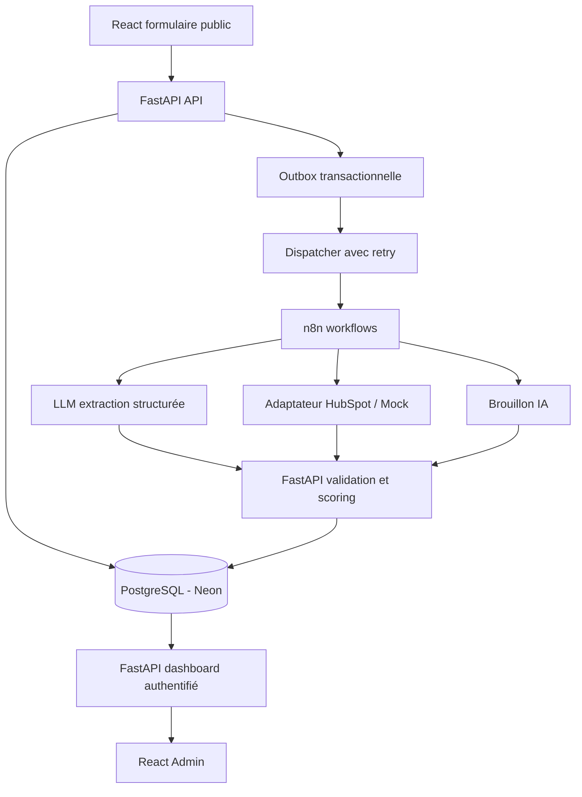

# LeadFlow AI — Cahier des charges fonctionnel et technique

**Version :** 1.0 · **Date :** 15 octobre 2026 · **État :** conception

## 1. Vision produit

LeadFlow AI automatise la réception, la qualification et l'organisation des demandes commerciales pour les petites agences B2B. Sa valeur est de réduire la saisie répétitive, rendre la qualification explicable et synchroniser le CRM sans compromettre le contrôle humain.

**Scénario fictif :** agence NovaDigital, spécialisée en sites web, automatisation et solutions IA. Prospects provenant d'un formulaire web ; conseillers commerciaux consultent un tableau de bord et approuvent des brouillons de réponse.

**Public cible :** agences de conseil, marketing, services IT, intégrateurs, PME B2B.

**Positionnement :** produit de démonstration professionnel qui peut ensuite devenir une prestation d'intégration sur mesure. Ce n'est pas, au MVP, un SaaS multi-client ouvert au public.

## 2. Rôles

- Prospect : soumet une demande via un formulaire avec information sur l'usage de ses données.
- Commercial : lit le prospect, modifie si nécessaire les qualifications, approuve/rejette un brouillon.
- Administrateur : gère intégrations, erreurs, règles de scoring, utilisateurs de démonstration.
- Manager (V2) : analyse pipeline et métriques.

## 3. Fonctionnalités MVP (must-have)

| ID | Fonction | Résultat attendu |
| --- | --- | --- |
| F01 | Formulaire public | Nom, e-mail, société (facultatif), service, message, consentements pertinents |
| F02 | Validation | Rejet des formats invalides, texte trop long, spam/rate limit |
| F03 | Idempotence | Une soumission rejouée ne crée pas deux demandes |
| F04 | Déduplication contact | E-mail normalisé unique par organisation, mais historique des demandes conservé |
| F05 | Qualification IA | Intention, service, budget mentionné, échéance, langue, résumé, besoin de revue |
| F06 | Score explicable | Règles versionnées, score 0-100, facteurs conservés |
| F07 | CRM HubSpot | Création/mise à jour du contact ; statut synchronisation consultable ; mode mock |
| F08 | Brouillon | Réponse préparée, jamais envoyée directement en MVP |
| F09 | Validation humaine | Approuver, rejeter et éditer le brouillon ; historique des actions |
| F10 | Dashboard | Filtres, statuts, details, run history, erreurs |
| F11 | Fiabilité | Tentatives contrôlées, outbox, déduplication des appels et journal d'audit |
| F12 | Documentation | Installation locale, architecture, tests, captures fictives |

## 4. Hors périmètre MVP

- Envoi d'e-mails automatiques, campagnes de prospection, SMS et WhatsApp.
- Scraping ou achat de listes de contacts.
- Synchronisation bidirectionnelle CRM.
- Automatisation de la prise de rendez-vous.
- Plusieurs équipes/organisations actives, facturation SaaS, abonnement public.
- Importation de données clients réelles dans une démo publique.

## 5. V2

- Intégration Gmail et Microsoft Graph pour les demandes entrantes avec autorisation.
- Rappels et prise de rendez-vous avec vérification des disponibilités.
- Relances programmées uniquement après approbation, avec gestion des désinscriptions et des règles légales applicables.
- Multi-organisations avec sécurité tenant par tenant et RBAC éprouvé.
- CRM additionnels (Pipedrive, Salesforce) via adaptateur.
- Tests A/B de formulation de réponses ; monitoring de dérive des modèles.
- Métriques funnel / conversion basées sur données vérifiables.

## 6. Architecture logique



**Source de vérité :** PostgreSQL. **Orchestrateur :** n8n. **Contrôle métier :** FastAPI. **CRM externe :** projection réconciliable. **IA :** extraction et rédaction sous schéma, pas décision autonome d'envoi ou de rejet.

**MVP single tenant** avec `organization_id` dans les tables métier pour préparer la V2. Les routes admin imposent authentification ; l'accès public n'expose ni données privées ni tableau de bord.

## 7. Parcours nominal

1. Un prospect fictif envoie le formulaire avec un identifiant de requête unique.
2. FastAPI valide les champs, limite les abus, normalise l'e-mail, crée/actualise un contact, crée une **nouvelle demande** et écrit un événement outbox dans la même transaction.
3. Un dispatcher remet l'événement à n8n (authentification service-to-service). La réponse HTTP publique ne dépend pas du succès immédiat du CRM ni du LLM.
4. n8n sollicite le LLM avec un schéma de sortie strict ; refus, timeout ou sortie incohérente => revue manuelle.
5. FastAPI valide la sortie, calcule score et catégorie déterministes, journalise règles et version du modèle.
6. n8n synchronise le contact avec HubSpot en mode test ou mode `CRM_PROVIDER=mock`.
7. n8n prépare un brouillon de relance, conservé avec le statut `DRAFT`.
8. Un commercial visualise, corrige et approuve/rejette le brouillon. En MVP, cette approbation ne déclenche **aucun envoi**.
9. Le dashboard affiche le suivi et les événements sans inventer de temps réel ni de succès.

## 8. Scoring explicable (proposition initiale, modifiable)

- Service déclaré dans le catalogue de l'agence : +30.
- Budget déclaré égal ou supérieur au minimum du service : +25.
- Échéance indiquée <= 30 jours : +20.
- Message décrivant clairement un besoin concret : +15.
- Coordonnées jugées suffisamment complètes : +10.

Total : 0 à 100. Segments `HOT >= 75`, `WARM >= 45`, `COLD < 45`. L'absence de budget **n'exclut personne**. Ne pas utiliser de caractéristiques personnelles sensibles ou de proxys non justifiés pour noter des prospects. Le score aide au tri, pas à la décision automatique de refus. Les seuils sont expérimentaux jusqu'à l'évaluation métier.

## 9. Contrat IA

Extraire un JSON validé avec un schéma explicite :

```json
{
  "intent": "automation",
  "service": "customer_support_automation",
  "budget_amount": 3000,
  "budget_currency": "EUR",
  "timeline_days": 30,
  "language": "fr",
  "summary": "Recherche d'automatisation du support client",
  "need_clarity": "clear",
  "needs_human_review": false,
  "evidence": ["automatiser le traitement des demandes clients"]
}
```

Valeurs manquantes => `null` ou catégorie `unknown`. Ne jamais inventer budget, besoin ou date. Les messages entrants sont des données **non fiables**, jamais des instructions système (protection contre prompt injection). Limiter taille, sorties et budget. Seules les données nécessaires sont envoyées au fournisseur LLM. Le scoring est calculé hors LLM.

## 10. Maquettes de pages

- `/` : landing publique + proposition commerciale + bouton démonstration.
- `/demo` : formulaire avec données fictives préremplies et notice explicite.
- `/login` : authentification de l'espace opérationnel.
- `/app/overview` : KPI calculés, pipeline, échecs, statuts des workflows.
- `/app/leads` : tableau filtrable / triable ; pas de faux chiffres live.
- `/app/leads/:id` : source, extraction IA, score explicable, CRM, brouillon, audit.
- `/app/reviews` : brouillons à valider.
- `/app/runs` : historique automatisations, erreurs et relances manuelles.

Les comptes de démo n'accèdent qu'aux données synthétiques. Les secrets et webhooks internes ne sont jamais visibles dans le client.

## 11. Exigences non fonctionnelles

- Authentification et autorisation serveur ; sessions sécurisées ou jetons vérifiés ; restriction du rôle sur chaque endpoint.
- Validation serveur des entrées, taille maximale des messages, rate limiting, CORS limité, contrôle de spam, protection CSRF si cookies.
- Secrets dans variables d'environnement/gestionnaire de secrets, jamais Git ni React.
- Endpoints n8n et callbacks privés authentifiés, TLS, idempotence et vérification de l'origine quand approprié.
- Erreurs réseau/API : backoff exponentiel pour 429/5xx, limites d'essais, statut `MANUAL_REVIEW` après échec définitif.
- Journalisation structurée avec `correlation_id`, sans copier le texte intégral des prospects dans les logs techniques.
- Délais configurables, version des règles, tests de qualité de classification sur jeux de données fictifs annotés.
- Minimisation des données, notice de confidentialité, suppression/export sur demande et calendrier de rétention explicite avant usage réel.
- Accessibilité au clavier, responsive mobile, états de chargement, d'erreur et d'absence de données.

## 12. Métriques à calculer et publier de façon honnête

- Temps médian entre réception et qualification terminée (p50/p95, sur jeu de test).
- Taux de sortie IA valide suivant le schéma.
- Précision d'intention sur jeu de 30 à 50 exemples labellisés.
- Taux de duplication des contacts après traitement.
- Taux de synchronisation CRM réussie après retries.
- Nombre de brouillons approuvés, corrigés et rejetés (uniquement données fictives de démo).
- Coût moyen LLM par qualification observé sur les usages de test.

Ne pas déclarer de KPI réel avant mesure. Ne pas présenter un test fictif comme des résultats clients.

## 13. Stratégie de déploiement économique

- **Dev local :** Docker Compose pour PostgreSQL, FastAPI, frontend et n8n si une instance n'est pas disponible.
- **Base démo :** Neon Free, projet distinct de tout autre produit ; quota à vérifier avant utilisation.
- **n8n :** réutiliser une instance self-hosted existante si capacité et licence conviennent, avec credentials et workflows LeadFlow isolés ; sinon local.
- **CRM :** HubSpot gratuit à des fins de test, ou adaptateur mock pour développement sans compte.
- **API :** Render Free seulement pour prototype, sachant qu'il s'endort après 15 minutes d'inactivité et peut présenter une reprise lente. Pas de garantie de production.
- **Web :** Netlify en site statique, dans les quotas du plan choisi.
- **LLM :** modèle abordable, configurable via `LLM_MODEL`, comptabilisation des tokens et seuil mensuel de dépenses. Tester le modèle actuellement disponible et ses sorties structurées.

Éviter d'héberger n8n avec stockage volatil. Sauvegarder les données, fixer des versions, monitorer les erreurs et séparer les comptes d'essai.

## 14. Jalons et définition du MVP terminé

**Sprint 1 : fondations (1-2 j)** : monorepo, Compose, schéma, migrations, formulaire public, validations, enregistrement durable, tests.

**Sprint 2 : intelligence (2-3 j)** : contrat IA + mode mock, scoring, événements outbox, orchestration n8n, logs d'exécution.

**Sprint 3 : CRM et revue (2-3 j)** : HubSpot mock puis vraie sandbox, déduplication, brouillons, approbation humaine.

**Sprint 4 : démonstration (2-3 j)** : dashboard, tests d'échec, documentation, déploiement démo, captures et vidéo.

**MVP fini si** : les 5 scénarios de prospects passent, une répétition de requête ne duplique rien, une panne CRM ne perd aucune demande, une sortie LLM incorrecte est traitée sans crash, un brouillon n'est jamais envoyé sans action dédiée, build/test passent, aucune clé n'est exposée, et démo publiable avec données fictives.

**Durée indicative :** 7 à 11 jours de développement concentré, selon familiarité, outils et accès aux services ; ce n'est pas un engagement de livraison.

## 15. Présentation CV/portfolio après réalisation

Titre : `LeadFlow AI — Intelligent CRM & Sales Automation`.

Description : "Plateforme de qualification de prospects B2B avec extraction structurée par IA, scoring explicable, orchestration n8n, synchronisation HubSpot, revue humaine et monitoring des workflows. Stack : FastAPI, React, PostgreSQL, n8n, OpenAI."

Mentionner "prototype", "démo déployée" ou "production" uniquement selon le statut effectivement vérifié. Ajouter capture de dashboard, diagramme système, vidéo courte et un tableau de tests avec métriques vérifiées.
